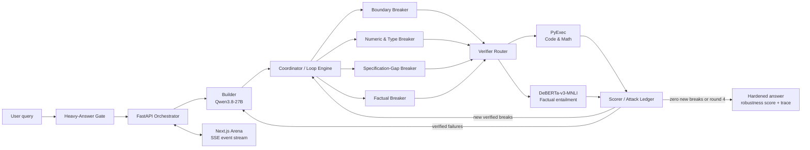

<h1 align="center">CRUCIBLE</h1>
<p align="center"><b>Trust infrastructure for AI outputs.</b><br>
Code goes in. Adversaries hammer it. Only what survives reaches you.</p>

<p align="center">
  <a href="https://github.com/kartik-sc/crucible"></a>
  <a href="https://github.com/kartik-sc/crucible/network/members"></a>
  <a href="https://github.com/kartik-sc/crucible/issues"></a>
  <a href="https://github.com/kartik-sc/crucible/blob/main/LICENSE"></a>
  <a href="https://github.com/kartik-sc/crucible"></a>
</p>

<p align="center">
Hacktoberfest Hack Day Bengaluru 2026 &middot; Track 2 — Best Open-Source AI Project<br>
Primary approach: <b>O1 Autonomous Agent Swarms</b> (+ O3 Trustworthy &amp; Verifiable AI)
</p>

---

## Contents

- [The problem](#the-problem)
- [What CRUCIBLE does](#what-crucible-does)
- [How it works](#how-it-works)
- [System architecture](#system-architecture)
- [Domains](#domains)
- [Tech stack](#tech-stack)
- [Repository structure](#repository-structure)
- [Run locally](#run-locally)
- [Configuration](#configuration)
- [Development](#development)
- [Live demo](#live-demo)
- [Contributing](#contributing)
- [Team](#team)
- [License](#license)

## The problem

LLMs give confident answers that are subtly wrong — a broken edge case, a
fabricated citation, an arithmetic slip — and you usually **cannot tell which**.
Scoring the final answer is not enough; the failure hides inside it.

## What CRUCIBLE does

CRUCIBLE puts a heavy answer on trial. A **Builder** agent produces it; a
**swarm of four specialized adversary agents** attacks it — each attack carrying
**checkable evidence** (a failing test, a computation, a claim + source). Every
attack is settled by a **verifier that executes code/math or runs entailment on
sources — never by another model's opinion**. Verified failures go back to the
Builder, which patches. The loop repeats until a round lands zero new breaks.

You get the hardened answer, a **robustness score**, and a visible attack trace.

> The one rule: a breaker never wins by assertion. No evidence, no strike.

## How it works

```text
query -> Heavy-Answer Gate -> Builder -> Breaker swarm (x4, parallel)
      -> Verifier (execute / entail) -> Scorer -> patch -> loop (<= 4 rounds)
```

1. The **Heavy-Answer Gate** keeps simple requests out of the expensive trial loop.
2. The **Builder** creates an initial answer and records its assumptions.
3. Four specialized **Breaker** agents attack different failure surfaces in parallel.
4. The **Verifier** checks every proposed strike with executable code, deterministic computation, or source entailment.
5. The **Scorer** calculates robustness from verified failures and surviving checks.
6. Verified failures are sent back to the Builder as a batched patch request.
7. The loop stops after four rounds or when a round produces zero new verified breaks.

See [docs/ARCHITECTURE.md](./docs/ARCHITECTURE.md) for the full diagram, module map, and design decisions.

## System architecture



### Core design principles

- **Evidence-first attacks:** an attack must contain exactly one checkable evidence payload.
- **Independent verification:** code and math are executed deterministically; factual claims are checked with retrieval and entailment.
- **Model diversity:** the Builder and Breaker swarm use different model families to reduce correlated blind spots.
- **Parallel adversarial search:** four breaker roles run concurrently to reduce latency.
- **Auditable output:** every state transition, attack, verdict, score, and patch is exposed in the event trace.
- **Bounded execution:** the loop has a maximum of four rounds and verifiers enforce timeouts and sandbox restrictions.

## Domains

| Domain | Attacks for | Ground truth |
|---|---|---|
| Code | edge cases / failing inputs | sandboxed Python runs the test |
| Math | arithmetic / unit / logic errors | Python computes the answer |
| Factual | unsupported / contradicted claims | retrieval + DeBERTa-v3-MNLI entailment |

## Tech stack

### Product stack

- **Frontend:** Next.js 15, React 19, TypeScript, Tailwind CSS, Framer Motion, Vitest
- **Backend:** Python, FastAPI, Uvicorn, Pydantic, HTTPX, python-dotenv
- **Deployment:** Vercel for the frontend and Render for the always-on FastAPI orchestrator
- **Streaming:** HTTP `fetch` with a `ReadableStream` parser for the backend's POST-based SSE event stream
- **Browser mirror:** Pyodide for audience-facing code and math verification in the arena

### Intelligence and verification stack

- **Builder model:** `Qwen3.8-27B`
- **Breaker model:** `Gemma 4 26B A4B IT`
- **Factual verifier:** `DeBERTa-v3-MNLI` for natural-language entailment
- **Code and math verifier:** sandboxed Python execution with a two-second timeout and no network access
- **Breaker roles:** boundary, numeric/type, specification-gap, and factual adversaries
- **Orchestration:** finite-state loop engine with coordinator fan-out, attack deduplication, a shared attack ledger, and batched Builder patches

### Runtime flow

```text
Next.js arena
  -> POST /run
  -> FastAPI orchestrator
  -> Builder + four parallel Breakers
  -> evidence-aware verifier router
  -> scorer and attack ledger
  -> SSE events back to the arena
```

## Repository structure

```text
.
├── docs/
│   └── ARCHITECTURE.md       # system architecture and design decisions
├── server/
│   ├── app.py                # FastAPI routes and SSE stream
│   ├── contracts.py           # Pydantic wire contracts
│   ├── config.py              # settings and loop constants
│   ├── orchestrator/          # FSM, coordinator, ledger, gate, and events
│   ├── breakers/              # Builder, Breaker swarm, auditors, and oracles
│   ├── verifiers/             # code/math execution and factual NLI verification
│   └── tests/                 # backend tests
├── web/
│   ├── app/                   # Next.js application
│   ├── components/            # arena UI components
│   ├── hooks/                 # stream and state hooks
│   └── lib/                   # types, reducer, mock stream, and SSE parser
├── CONTRIBUTING.md            # contribution workflow
├── LICENSE                    # MIT license
└── README.md
```

## Run locally

### Prerequisites

- Python 3.11+
- Node.js 20+
- npm
- API credentials for the configured model providers when running real agents

### 1. Clone and configure

```bash
git clone https://github.com/kartik-sc/crucible.git
cd crucible
cp .env.example .env
```

Fill in the required provider keys in `.env`. Never commit secrets or production credentials.

### 2. Start the backend

```bash
cd server
python -m venv .venv
source .venv/bin/activate       # Windows: .venv\\Scripts\\activate
pip install -r requirements.txt
uvicorn app:app --reload
```

The API is available at `http://localhost:8000`. The default fake-agent mode is useful for local UI development without model keys.

### 3. Start the frontend

In a second terminal:

```bash
cd web
npm install
npm run dev
```

Open `http://localhost:3000`.

## Configuration

The frontend can run against a local mock stream or the live backend. To connect it to a local FastAPI instance, create `web/.env.local`:

```bash
NEXT_PUBLIC_API_URL=http://localhost:8000
```

To use the deployed backend, set the same variable to its Render URL. See [.env.example](./.env.example), [server/README.md](./server/README.md), and [web/README.md](./web/README.md) for component-specific configuration and integration details.

## Development

### Backend checks

```bash
cd server
python -m pytest -q
```

### Frontend checks

```bash
cd web
npm run typecheck
npm run lint
npm test
npm run build
```

### API smoke test

```bash
curl -N -X POST http://localhost:8000/run \\
  -H 'content-type: application/json' \\
  -d '{"query":"Return the nth Fibonacci number, n >= 0.","domain":"code"}'
```

For a deterministic demo without model keys, use `GET /mock/run?domain=code|math|factual`.

## Live demo

Try the deployed arena: **[crucible-xi-eight.vercel.app](https://crucible-xi-eight.vercel.app/)**

## Contributing

Contributions are welcome, especially improvements to verifiers, breaker strategies, test fixtures, documentation, and the arena experience.

1. Read [CONTRIBUTING.md](./CONTRIBUTING.md).
2. Open or search an issue before starting substantial work.
3. Create a focused branch and add tests for behavior changes.
4. Run the backend and frontend checks locally.
5. Open a pull request with a clear description of the change and its verification evidence.

This repository is participating in **Hacktoberfest 2026**. Please keep contributions focused, reproducible, respectful, and aligned with the evidence-first design of CRUCIBLE.

## Team

- [Udit H](https://github.com/Udit-H)
- [Ansh Patel](https://github.com/ansh1646)
- [Kartik Chandra](https://github.com/kartik-sc)

## License

MIT — see [LICENSE](./LICENSE).
